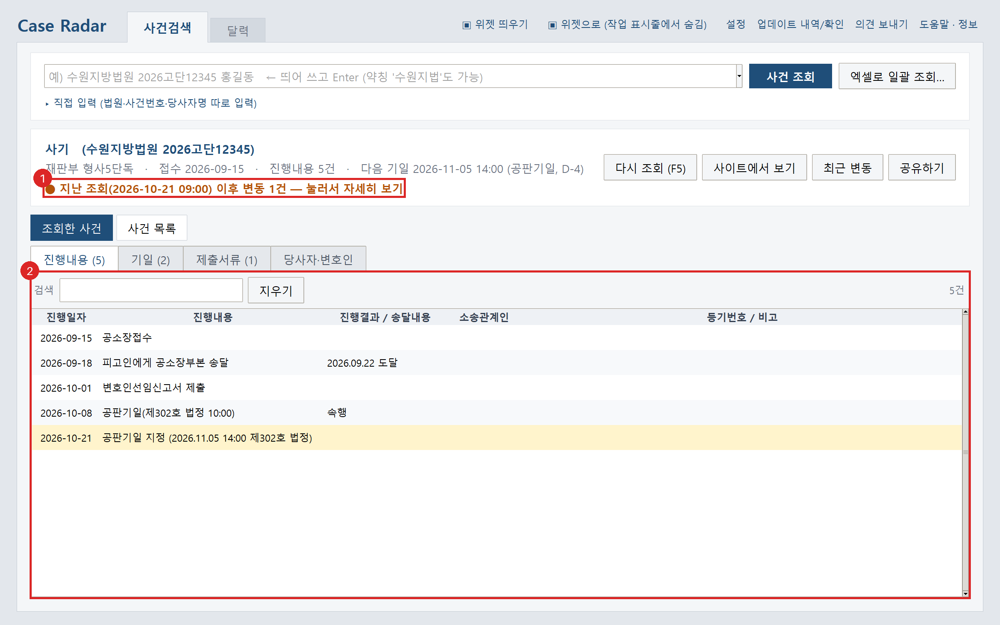
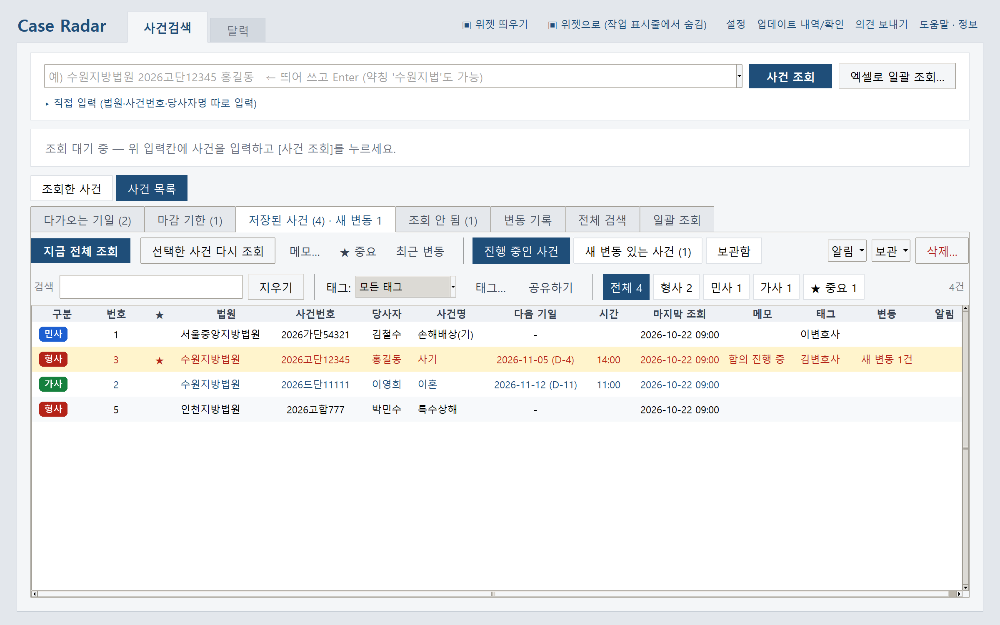
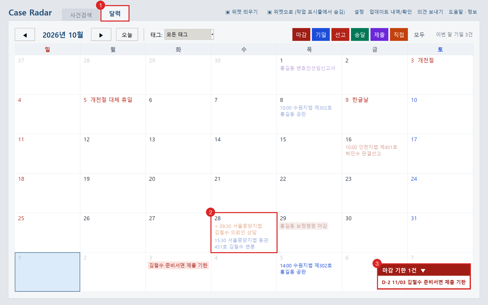
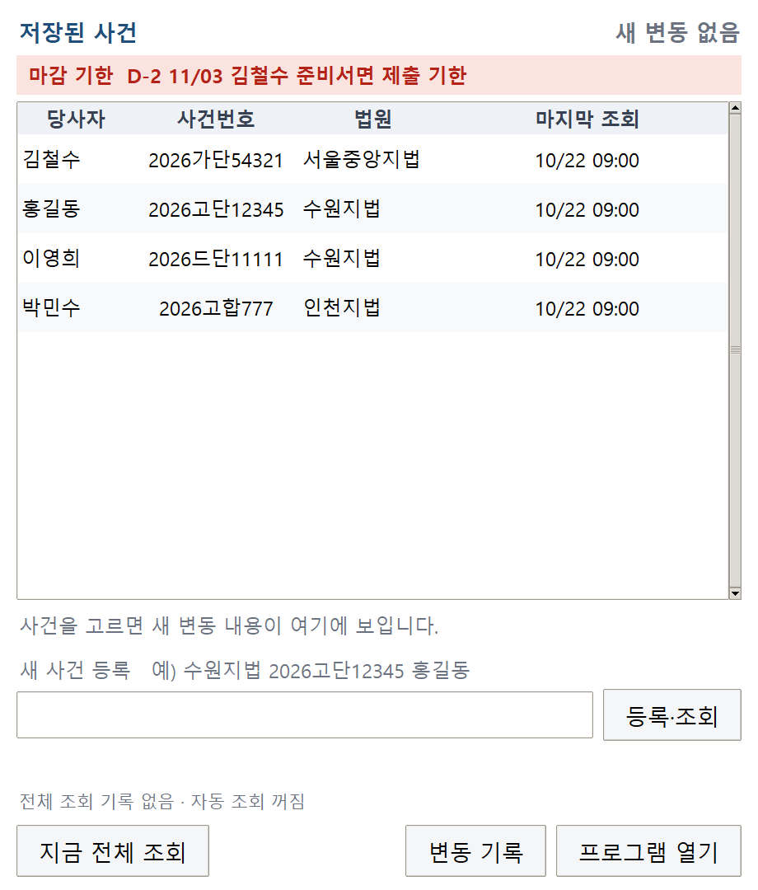

# Case Radar

대법원 **나의사건검색**을 대신 조회해, 맡은 사건들의 기일·제출서류·진행내용을 한곳에 모으고 **지난번과 달라진 것만** 알려 주는 Windows 프로그램입니다.

법률 사무 현장에서 사건마다 사이트에 들어가 보안문자를 풀고 진행 상황을 확인하던 일을 줄이려고 만들었습니다.

> 이 저장소는 **배포용**입니다. 실행 파일(`CaseRadar.exe`)은 [Releases](../../releases/latest)에 올라가며, 프로그램이 이곳에서 새 버전을 확인해 스스로 업데이트합니다.
> 대법원과 관계없는 비공식 프로그램입니다. 아래 화면의 사건·이름은 모두 가짜 데이터입니다.

## 주요 기능

- **보안문자 자동 입력**: 법원·사건번호·당사자명만 넣으면 OCR로 캡차를 읽어 조회합니다. 못 읽으면 자동으로 다시 시도합니다.
- **바뀐 것만 표시**: 다시 조회하면 새 기일·새 서류·송달 결과처럼 지난번과 달라진 줄을 강조합니다.
- **한 번에 전체 조회**: 저장된 사건을 버튼 하나로, 또는 정해 둔 시각에 자동으로 모두 다시 조회하고 변동이 있으면 알려 줍니다.
- **엑셀 일괄 등록**: 전자소송포털 사건목록 엑셀을 고치지 않고 그대로 넣으면 한꺼번에 등록·조회합니다. 조회되지 않는 사건은 이유와 함께 따로 모읍니다.
- **달력과 기한**: 기일·선고·송달·제출·마감을 한 달 달력으로 보고, 상소기간(참고용)과 서류 마감 기한을 D-day로 보여 줍니다.
- **바탕화면 위젯**과 트레이 아이콘, 의뢰인 안내 문구 만들기
- **자동 업데이트**, 오류 보고 시 사건번호·이름 자동 가림

| 저장된 사건 | 달력 |
|---|---|
|  |  |

## 설치와 실행

1. [Releases](../../releases/latest)에서 `CaseRadar.exe`를 받아 바탕화면이나 문서 폴더에 둡니다. 설치 과정은 없습니다.
   - `C:\Program Files` 같은 관리자 폴더에 두면 자동 업데이트가 되지 않습니다.
2. 두 번 클릭해 실행합니다. "Windows의 PC 보호" 창이 뜨면 **추가 정보 → 실행**을 누릅니다. (코드 서명 인증서가 없어 뜨는 안내입니다.)
3. 맨 위 입력칸에 `수원지법 2026고단12345 홍길동`처럼 띄어 써서 넣고 Enter를 누릅니다.

**필요한 것**: Windows 10/11, Edge 또는 Chrome, 인터넷 연결

**데이터 저장 위치**: 조회 기록과 설정은 이 PC의 `%LOCALAPPDATA%\scourt_monitor`에만 저장되며, exe를 옮기거나 새 버전으로 바꿔도 그대로 남습니다.

## 만든 방식

- 브라우저를 켜 둔 채 재사용하고 쉬는 동안 다음 조회를 준비해, 1건 조회 시간을 약 8초에서 1~3초로 줄였습니다.
- 저장 도중 꺼져도 파일이 깨지지 않도록 저장하고, 경로 조작과 엑셀 수식 주입을 막습니다.

**기술**: Python, Tkinter, Playwright, ddddocr(OCR), openpyxl, PyInstaller, GitHub Releases, pytest
